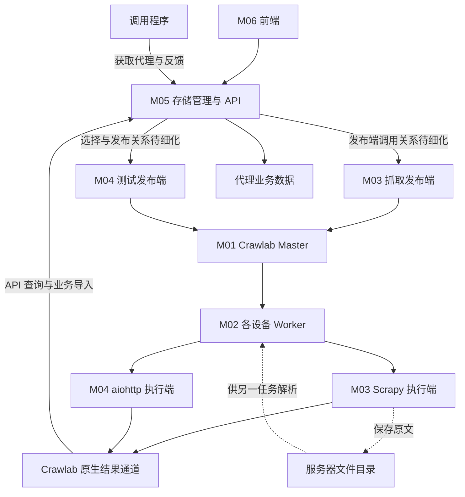

# 历史讨论稿，非当前实施规范

2026-10-29 本地实现前的讨论快照；包含已撤回方案。当前入口为根 README 和 docs/protocol.md。

# 爬虫集群代码模块与运行架构

2026-10-27本地HTTP入库更新：用户授权的接收→SQLite→提交确认→读取联调已通过，合计59项自动检查及三个结果入库／重传示例通过。只接收示例仍返回persisted=false；task_id仅为可信本地发布侧绑定，不是Crawlab认证。正式评分策略／生产接口及原生Task端到端未完成，未执行服务器操作。

2026-10-27实施范围：已有 [M05本地验证切片](../../apps/proxypool/service/README.md)，用户授权的合成HTTP回传及SQLite内部32项测试已通过。HTTP接收确认不表示入库，SQLite仍单独内部验证；该本地阶段不含Worker联调；随后服务器Worker容器合成回传和完整清理已按用户输出通过，仍未做原生Task→M05→SQLite联调，完整协议／字段及正式评分策略未定稿。下文较早“尚未实现”描述的是当时研究阶段或完整方案，不否认本轮有限切片；不得据此把全部推荐方案标为已实现。

更新：2026-10-26。用户确认按实际代码模块与运行组件逐一讨论，并要求持续记录进度、始终考虑 CPU／内存／硬盘等资源。下列 M01—M08 为已确认的模块边界；具体入口、版本、发布端进程划分、资源预算及协议细节仍需审阅和验证。Crawlab／Scrapy 的复用依据见 [框架参考](../framework-references.md)，不因确认边界就表示已实现或部署。

## 已确认代码模块

官方文档后的最新优化建议（2026-10-25，待确认）：M01／M02 原生管理不变；M03 固定来源优先使用 Spider 登记和 Schedule；M04 只补业务选测及小批 API 发布；M05 仍独占 SQLite；用户2026-10-26已选择Worker直接回传M05，原生结果导入仅保留历史比较；M06 只补业务页面，M07 保持薄适配。业务各模块可先在一个后端进程运行，不自动拆成独立发布／回调／恢复容器。原生暂存有额外 I/O、空间与延迟，需有界验证；不直接让原生 SQLite 适配写业务主库。详细建议唯一维护在 [方法设计](../../apps/proxypool/design.md)。0.7 文档与当前发行镜像渠道有差异，本轮建议保留 0.6.3 体验，没有升级；主业务通道现已确认，但尚无业务实现。

2026-10-25 用户新系统设想进入评估：M03 来源插件发布、M04 同目标配置的代理切小批执行、代理获取的有界内存候选队列、M05 统一批写与生命周期、M06 共用前端。完整评估以 [Proxypool 当前系统方案](../../apps/proxypool/design.md) 为准；其中 100 项／小任务、10s 窗口是用户示例，助手的状态／缓存修正尚待确认。获取保持独立代码职责，暂可复用 service/allocation，不自动增加模块编号或独立容器。后端 API 持久保存状态，Worker 不调用浏览器；前端只展示。此前按每个代理一个原生任务的讨论不再作为当前任务粒度。

| 编号 | 代码模块／组件 | 运行位置 | 代码职责与边界 |
| --- | --- | --- | --- |
| M01 | Crawlab Master | 家庭服务器独立容器，专用平台 MongoDB 实例 | 上游调度、节点、代码同步、任务状态和日志；用户已选择 Mongo 专用，本仓库维护部署与接入约定，平台数据库等依赖计入此组件成本 |
| M02 | Crawlab Worker | 服务器及其他设备的一系列容器 | 上游执行节点、任务子进程和运行依赖；可选服务器 Worker 最多并行一个任务，外部节点逐台确定能力 |
| M03 | Proxypool 抓取任务模块 apps/proxypool/crawler/ | 发布端在服务器，执行端在 Worker | 来源登记、脚本启停、抓取任务发布；标准 Scrapy Spider、提取、结果输出及来源统计 |
| M04 | Proxypool 测试任务模块 apps/proxypool/tester/ | 选择／发布端在服务器，执行端在 Worker | 按证据选择待测组合、生成与发布测试批次；aiohttp 执行并输出逐项结果 |
| M05 | Proxypool 代理存储管理模块 apps/proxypool/service/ | 家庭服务器 | 独占SQLite业务读写；直接结果接收、去重、评分、分发反馈API、容量和清理；库中的来源／目标记录不意味着将 M03／M04 代码职责合并 |
| M06 | Proxypool 前端 apps/proxypool/web/ | 浏览器及静态资源服务 | 通过业务 API 管理配置、展示健康／质量／容量；不直接访问数据库 |
| M07 | Crawlab 接入库 integrations/crawlab/ | 被服务器及 Worker 程序引用 | 固定所需平台 API、配套结果通道及版本薄适配，是依赖库，不是额外常驻平台 |
| M08 | 其他爬虫应用 apps/<业务名称>/ | 各业务服务器端／Worker | 各自维护输入、发布、抓取或解析与存储规则，复用同一 Crawlab 集群；当前不新增未指定业务 |

目录表示确认的代码归属；当前仅M05有本地验证切片，其他内部目录仍是草案。M03／M04 内部均明确分发布端与执行端；服务器发布端分别常驻还是由一个进程加载，结合资源和独立故障需求后确认。M05 的内部子包为 api、storage、importer、quality、allocation、lifecycle，不据此拆成六个独立服务。跨设备原文和解析入口放在对应业务应用中，原文先持久化再发布解析；不另造通用 runner 平台。

功能与代码的映射：来源管理主要属于 M03，测试规则及选择主要属于 M04；持久化、并发一致性和评价写入归 M05。M06 展示已有数据，M07 仅桥接平台。来源／目标 CRUD 的 API 入口可由 M05 提供，但应调用对应业务模块或规定接口，具体依赖和接口在各模块审阅中确定，不把概念拆分直接当独立 HTTP 服务。

## 数据流

图中原生结果通道表示候选 A，不是已选定的业务集成；候选 B 和统一方案状态见 [数据协议](../protocol.md#业务回传方案状态2026-10-26)。已有平台 smoke／API 验证与未实现的业务回传分别记录。代码同步与 HTML 传输分别处理。来源采集先同一任务抓取并解析，分步模式随后验证，业务输入输出保持一致。

图中连线表示逻辑调用和数据流，不预定发布端进程或新增 HTTP 接口；M07 由相关程序引用。M05 内部处理入口与最终模块接口须在逐模块审阅时明确。

## 每个模块必须记录的资源评估

资源评估属于每个模块的方案审阅。记录位置与进度入口为 [progress.md](../../progress.md)，模块技术方案在本文件或对应模块文档，禁止多份不一致的配额定义。资源数据要标明用户确认／方案预算／按假设估算／实际测试，注明环境和时间。

| 项目 | 每个模块需要明确 |
| --- | --- |
| 运行与依赖 | 哪台设备、常驻进程还是短任务、同进程还是分容器、上游依赖与镜像数量；启动、空闲和升级期间也计成本 |
| CPU | 常态／峰值负载来源，解析／评分／压缩等计算，每设备并行任务与每任务内部并发，超时及资源不足时的排队或拒绝 |
| 内存 | 常驻基础占用、单任务峰值、同时任务数、原文大小和缓冲上限、客户端连接及数据库缓存；限制与故障处理不只看平均值 |
| 磁盘容量 | 主库、索引、WAL、平台结果、原文、日志、镜像和临时文件分别预算；条数、字节、保留期、峰值和清理／满额行为 |
| 磁盘 I/O | 合批提交、清理、checkpoint、导入及索引更新的频率，避免全部设备同时回传引起集中写入 |
| 网络 | 单任务请求数／响应体上限、并发与速率、代码同步／结果／原文流量，节点离线或限速时的行为 |
| 整机与扩展 | 按服务器和每台 Worker 分别汇总；系统及现有服务留余量，共享依赖计一次，多个容器／任务并行时累计峰值；不直接把新模块预算等同整机可用资源 |
| 验证 | 预算依据、关键假设、候选方案取舍、最小隔离测试和可接受标准；未测试的精确占用明确写待评估 |

| 模块 | 首要资源关注点 | 当前定量状态 |
| --- | --- | --- |
| M01 | Master 与实际版本所需依赖的常驻内存、平台结果／日志、同步和查询开销 | Master／专用 MongoDB 基础部署已通过；体验配置有初始容器限制，实际资源占用及长期容量未验收，见 [部署说明](../../deploy/crawlab/README.md) |
| M02 | Worker 基础占用＋任务峰值，依赖镜像、同步临时空间、每设备能力与任务并发 | 现有服务器 Worker 已按一任务槽部署并验证内网路径；初始容器限制不等于实测，其他设备配额待定 |
| M03 | 请求并发与页面上限、HTML 缓冲、解析 CPU、结果量及来源重叠 | 只有候选框架和草案限制，尚未量测 |
| M04 | 全局测试预算、单任务并发、连接／超时、服务器选择开销与回传量 | 既有测试参数是建议，无性能验证 |
| M05 | SQLite 单写事务、有限样本、短期凭证、WAL／清理、主文件空间 | 详见 [存储方案](../../apps/proxypool/storage.md)；数字均为推荐预算，未压测 |
| M06 | 浏览器刷新频率／分页、API 请求量、静态资源与必要服务进程 | 技术与定量预算待定 |
| M07 | SDK 依赖、连接池、重试与结果缓冲、平台查询频率 | 随配套版本确认，不预建常驻服务 |
| M08 | 各业务额外依赖、任务峰值与对共用节点／Master 的累计影响 | 具体业务未指定，接入前评估 |

比较方案时同时看稳定性与资源：例如发布端合并可减少常驻进程，分开便于独立运行；大批量可减少提交频率，也增加缓冲和单次耗时；缩短保留期会减少磁盘但缩短补报窗口。根据目标与实测选择，不能只因能运行就继续叠加组件或放开上限。

## 调度与来源热插拔

一个来源对应一个网站脚本。来源登记映射到固定的允许文件或 Spider，固定周期复用 Crawlab Schedule。前端开关同步到调度配置，执行前复查来源是否仍启用；未登记文件不会因放进目录而执行。

Worker 运行短生命周期任务，下一任务加载已同步的代码，不要求主服务重启或实现常驻 Python 模块 reload。若选定平台不能避免同来源重叠，只补来源级在途检查，不扩展成通用调度系统。分钟级周期与任意秒级周期的能力要分清。

自测取决于近期访问记录，因此由 Proxypool 选择代理与目标组合后发布；固定抓取周期与自测业务判断不由两套定时器重复执行。

## 数据归属

已确认设计方向补充：用户接受用缓存队列积累后写入，并要求整套流程适合 SQLite。M05 继续独占业务数据库，反馈、批次／分发、配置和维护写入经同一有界入口组织短事务；Worker 经 API 共享数据，不直接写文件。内存队列只缓冲未确认请求，数据库状态和提交仍为依据；不新增 Redis 或第九个常驻服务作为默认实现。具体合批、读写和清理建议见 [SQLite 流程](../../apps/proxypool/storage.md)，不将方向确认当成字段／数值全部获批。

当前状态存储讨论：用户提出用状态连接抓取／测试发布、开始与完成，并询问 Redis 的共享作用。共享和持久不等于必须新增 Redis；平台任务执行状态已由 Crawlab 持久保存，业务状态可经统一业务 API 写入当前应用自己的数据库。Proxypool 的候选是既有 SQLite source_runs／check_batches，内存只放有限缓冲，不作为状态真值；其他应用用各自持久业务库，不强制全写 Proxypool 或共用一个内存字典。原生周期直发时排队状态已在平台，不必为了另写状态再造一套定时器。

Redis 是否引入仍未确认。需要多个业务共用可靠的细粒度 URL 队列时可评估，但不能仅因有多设备就新增一层状态双写；Redis 需要常驻资源、持久化及队列保留，并不能自动让其状态和业务 SQLite 同事务提交。保持反馈约定统一与业务数据归属分离，先按真实任务粒度和负载决定，不新增共享状态常驻服务作为默认模块。

Crawlab 保存执行过程和有限中转任务结果，Proxypool 保存无网站来源映射的代理资料、独立来源抓取统计、按目标的访问记录与质量汇总。来源页面／摘要不附代理清单；平台暂存结果仍属于运行任务，不等于业务长期维护代理来源。原生结果是可重复导入的执行产出，业务数据库是分发与评价的依据，不直接修改 Crawlab 内部集合。

业务不重复建设节点调度或通用 job／attempt／lease 服务。针对用户提出的逐 URL 成功与卡住恢复，候选补充本应用输入的 work_id、当前 generation、状态、期限和有限进度；平台 task_id 不能替代它。M03 负责发布／执行确认，M05 负责事务完成与有界核对，M07 保持平台薄适配，不新增常驻服务。只有当前轮次必要结果已落库与成功状态同事务提交才认定业务成功，方案见 [M03 闭环](../../plugins/README.md)，尚未实现。

## 其他爬虫

其他业务可复用 Crawlab，采用自己的 Scrapy 项目或普通执行脚本。无需全部实现 Proxypool 来源接口，也不强制使用某个公共 runner。跨业务共用的代码以已经重复出现的启动、结果适配为限，避免提前抽象通用工作流。

## 存储与部署

用户已接受 SQLite WAL：单个 Proxypool 业务服务持有本地文件，远程执行节点经 Crawlab 回传，调用程序经 HTTP 反馈。代理、独立来源统计、有上限的近期样本、短期凭证与当前质量归业务库；不保存代理来源映射或全量访问历史，不额外同步 Redis 排名。网站及其配置各为数据行，代理和目标网站的关联质量独立存储。容量及批量默认值仍为建议，依据与并发条件见 [存储方案](../../apps/proxypool/storage.md)，交互字段见 [协议](../protocol.md)，尚未实现或压测。

家庭服务器承载管理、业务和持久存储，可选最多一个并发任务的本地 Worker；其他设备增加 Worker。任务并发和程序内部并发分别限制。部署继续遵循 [服务器约束](../deployment.md)，本轮只修订文档。
